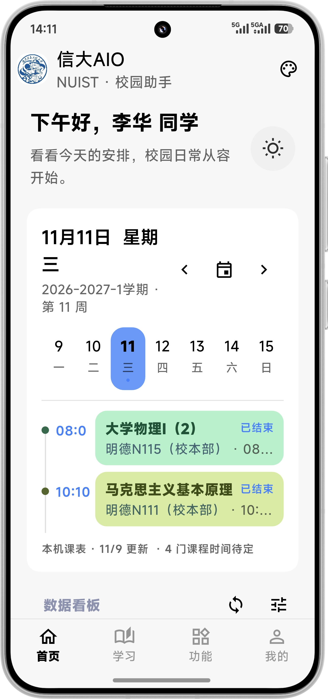
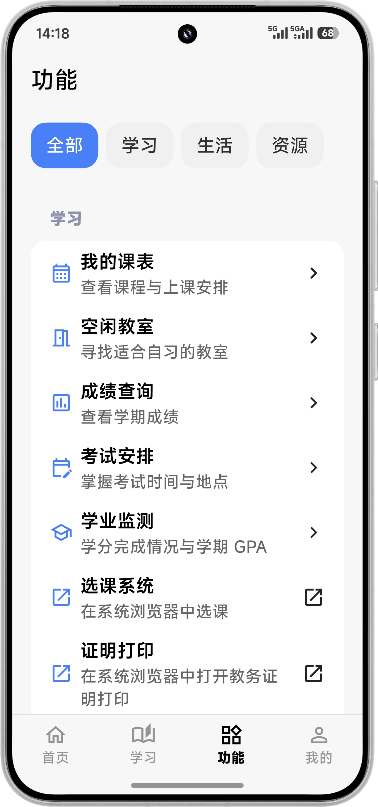
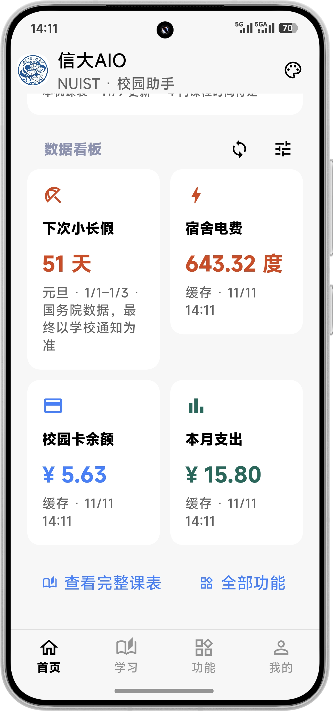
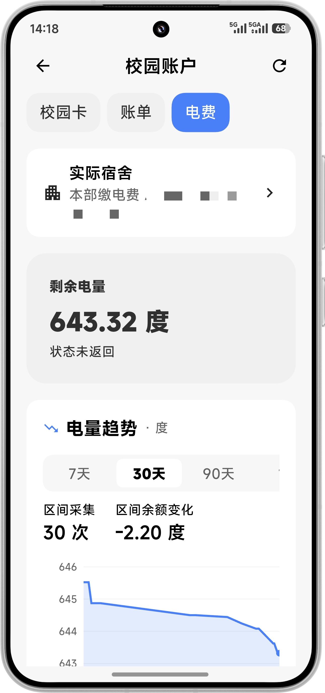
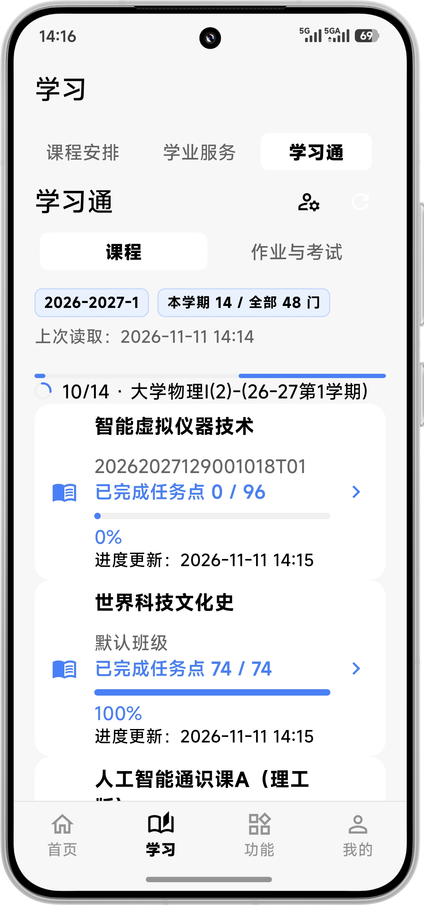
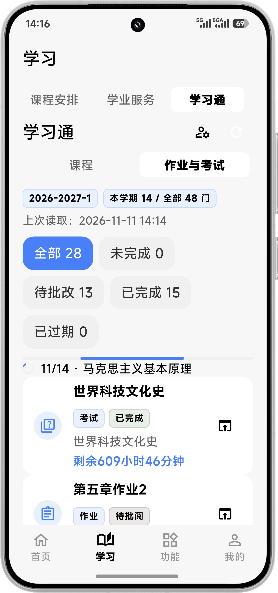

  

<h1 align="center">信大 AIO</h1>

为南京信息工程大学同学打造的校园助手，让校园生活简单一点。

  

## 核心亮点

- **校园服务，一处查看**：课表、成绩、校园卡、电费、公告与借阅信息集中呈现，减少在多个网站之间来回切换。
- **一天安排，清楚直观**：首页时间轴查看当天课程，周课表掌握整周安排，离线也能查看已缓存的课表。
- **两种风格，随心选择**：MD3 与 MIUIX 自由切换，支持主题配色、深浅色模式，以及 Android 动态取色。
- **校内校外，灵活访问**：支持校园直连与学校 WebVPN，按站点可达性自动选择常用内网入口的访问路径。

## 界面预览

<strong>首页与功能入口</strong>

<table>
  <tr>
    <th width="50%">首页 · 当天课程时间轴</th>
    <th width="50%">功能 · 常用校园服务</th>
  </tr>
  <tr>
    <td align="center"></td>
    <td align="center"></td>
  </tr>
</table>

<strong>校园账户与电量统计</strong>

<table>
  <tr>
    <th width="50%">数据看板 · 常用信息一览</th>
    <th width="50%">宿舍电费 · 电量变化趋势</th>
  </tr>
  <tr>
    <td align="center"></td>
    <td align="center"></td>
  </tr>
</table>

<strong>学习通课程与作业</strong>

<table>
  <tr>
    <th width="50%">课程 · 任务点完成进度</th>
    <th width="50%">作业与考试 · 状态汇总</th>
  </tr>
  <tr>
    <td align="center"></td>
    <td align="center"></td>
  </tr>
</table>

## 功能介绍

### 课表与教务

首页用紧凑时间轴展示当天课程，学习页提供周课表。支持课程导入、本地编辑与删除，适配每天 11 节课的作息，也能区分不同教学周的上课地点。

按教学楼查看教室全天空闲情况，查询考试安排、课程成绩、绩点和学分进度。需要进一步操作时，可以直接打开对应的学校网页。

### 学习通

集中查看本学期课程、任务点完成进度，以及作业和考试信息。需要学习或完成任务时，可以进入对应的官方课程页面。

### 校园卡与宿舍电费

查看校园卡余额、本月收支和历史账单，了解日常消费；选择自己的园区、楼栋和房间后，即可查询宿舍剩余电量。

常用账户信息也会呈现在首页，方便随手查看。

### 公告、校历与图书借阅

浏览学校近期公告，按分类、标题或发布部门查找信息，并打开正文与附件。校历支持切换学年和学期，查看教学周、寒暑假与校历事件。

图书借阅页展示当前借阅记录和归还日期，方便安排还书。

### 常用校园入口

选课系统、奥兰系统、证明打印、信大 E 修、信大 E 行和创新创业系统等入口统一收录，点击后使用系统浏览器打开。信大 E 家提供企业微信工作台的打开指引。

需要校园网的入口支持通过学校 WebVPN 访问，也可以在网络设置中手动选择访问方式。

### 个人资料与个性化

首次使用时，向导会引导你完成外观选择、学校登录、服务连接和宿舍选择。登录后可展示姓名、学号、学院、专业等资料，头像支持姓名文字样式或本地相册图片。

应用支持跟随系统深浅色、调整字体大小和首页卡片布局；Android 12 及以上可使用壁纸动态配色。更新设置支持启动检查与版本日志提醒，默认从 Gitee 获取更新，也可切换到 GitHub。

## 下载

前往 [Gitee 发行版](https://gitee.com/ded_retr0/NUIST-AIO/releases) 或 [GitHub Releases](https://github.com/makabaka11/NUIST-AIO/releases)，选择对应平台的安装包。版本更新内容可在发布页查看，已安装的应用也可通过「我的 → 更新设置」检查更新。

| 平台 | 下载与使用 |
| --- | --- |
| Android | 下载 `.apk` 安装。 |
| iOS | 下载 `.ipa`，需要自行签名后安装。 |
| macOS | 下载 `macos-universal.zip`，解压后将应用放入「应用程序」，支持 Apple 芯片与 Intel Mac；当前未进行 Apple 公证。 |
| Windows | 下载 `windows-x64.zip`，完整解压后运行 `nuist_aio.exe`；当前学校登录及依赖网页会话的查询尚未适配。 |

具体可下载的平台与版本以发布页附件为准。

## 交流与反馈

遇到问题或有新功能建议，欢迎提交 [GitHub Issue](https://github.com/makabaka11/NUIST-AIO/issues)，或发送邮件至 [ded000@retr0.xyz](mailto:ded000@retr0.xyz)。

反馈问题时，请附上应用版本、设备型号、系统版本、复现步骤及必要截图。截图中请遮挡个人信息，无需提供密码、验证码或登录凭据。

## License

本项目基于 [MIT License](LICENSE) 开源，Copyright © 2026 Retr0。使用的第三方组件与适配脚本遵循各自许可，可在应用内「开源许可」查看。

信大 AIO 是非学校官方的校园服务整合工具。账号密码在学校官方页面输入，登录凭据保留在本机；校园服务的实际可用性以学校系统为准。
